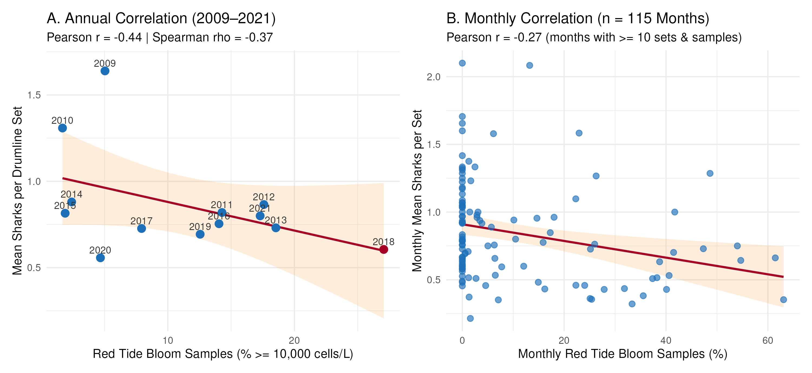
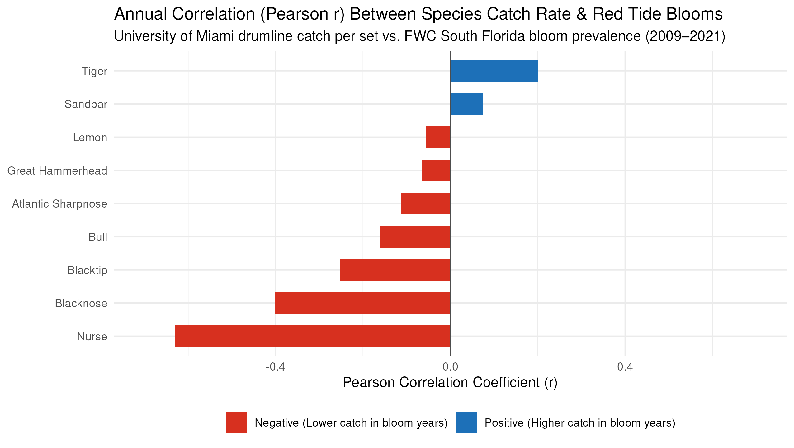

```{r}
#| label: setup
library(tidyverse)
library(patchwork)
library(knitr)
dir.create("images", showWarnings = FALSE)
```

To test how coastal shark catch rates relate to *Karenia brevis* harmful algal blooms, we join the **University of Miami drumline survey** (2009–2021) with **Florida FWC red tide water samples** across South Florida (`24.4°N–27.0°N`, `-82.8°W to -79.8°W`) by year and by month. Following FWC thresholds, a water sample is classified as an active red tide bloom when *Karenia brevis* concentrations reach **`>= 10,000` cells/L**.

```{r}
#| label: prepare-joined-data
sets_raw <- read_csv("data/miami_sharks/SharksBySet.csv") |>
  mutate(
    Date = ymd(str_extract(Sample, "^\\d{4}-\\d{1,2}-\\d{1,2}")),
    Year = year(Date),
    YearMonth = floor_date(Date, "month"),
    total_sharks = rowSums(across(Nurse:Spinner), na.rm = TRUE)
  ) |>
  filter(!is.na(Year))

fwc_files <- list.files("data/fwc_redtide", pattern = "\\.csv$", full.names = TRUE)
redtide_sf <- read_csv(fwc_files, col_types = cols(TIME = col_character())) |>
  mutate(
    SampleDate = as_date(ymd_hms(SAMPLE_DATE, quiet = TRUE)),
    Year = year(SampleDate),
    YearMonth = floor_date(SampleDate, "month")
  ) |>
  filter(
    Year >= 2009, Year <= 2021,
    LATITUDE >= 24.4, LATITUDE <= 27.0,
    LONGITUDE >= -82.8, LONGITUDE <= -79.8
  )

# Combined annual summary table (2009-2021)
annual_joined <- sets_raw |>
  summarize(
    sets = n(),
    sharks_caught = sum(total_sharks, na.rm = TRUE),
    mean_cpue = mean(total_sharks, na.rm = TRUE),
    .by = Year
  ) |>
  inner_join(
    redtide_sf |>
      summarize(
        fwc_samples = n(),
        bloom_pct = mean(COUNT_ >= 10000, na.rm = TRUE) * 100,
        mean_log_cells = mean(log10(COUNT_ + 1), na.rm = TRUE),
        .by = Year
      ),
    by = "Year"
  ) |>
  arrange(Year)

# Combined monthly summary (months with >= 10 drumline sets and >= 10 FWC samples)
monthly_joined <- sets_raw |>
  summarize(
    sets = n(),
    mean_cpue = mean(total_sharks, na.rm = TRUE),
    .by = YearMonth
  ) |>
  inner_join(
    redtide_sf |>
      summarize(
        fwc_samples = n(),
        bloom_pct = mean(COUNT_ >= 10000, na.rm = TRUE) * 100,
        .by = YearMonth
      ),
    by = "YearMonth"
  ) |>
  filter(sets >= 10, fwc_samples >= 10)

r_annual_pearson  <- cor(annual_joined$mean_cpue, annual_joined$bloom_pct)
r_annual_spearman <- cor(annual_joined$mean_cpue, annual_joined$bloom_pct, method = "spearman")
r_monthly_pearson <- cor(monthly_joined$mean_cpue, monthly_joined$bloom_pct)
```

## Annual & Monthly Correlation

Across the 13 survey years (2009–2021), mean sharks caught per drumline set and South Florida red tide bloom prevalence show a **moderate negative correlation**:

- **Annual Pearson correlation:** $r = `r round(r_annual_pearson, 2)`$ (Spearman rank $\rho = `r round(r_annual_spearman, 2)`$, $n = 13$ years)
- **Monthly Pearson correlation:** $r = `r round(r_monthly_pearson, 2)`$ ($n = `r nrow(monthly_joined)`$ well-sampled months with at least 10 drumline sets and 10 water samples)

```{r}
#| label: correlation-scatterplots
p_annual <- ggplot(annual_joined, aes(x = bloom_pct, y = mean_cpue)) +
  geom_smooth(method = "lm", color = "#a50026", fill = "#fdae61", alpha = 0.22, linewidth = 0.9) +
  geom_point(aes(color = Year == 2018), size = 3) +
  geom_text(
    aes(label = Year),
    nudge_y = 0.045, size = 3.1, color = "grey20", check_overlap = TRUE
  ) +
  scale_color_manual(values = c(`FALSE` = "#1d70b8", `TRUE` = "#a50026"), guide = "none") +
  labs(
    title = "A. Annual Correlation (2009–2021)",
    subtitle = paste0(
      "Pearson r = ", round(r_annual_pearson, 2),
      " | Spearman rho = ", round(r_annual_spearman, 2)
    ),
    x = "Red Tide Bloom Samples (% >= 10,000 cells/L)",
    y = "Mean Sharks per Drumline Set"
  ) +
  theme_minimal(base_size = 11)

p_monthly <- ggplot(monthly_joined, aes(x = bloom_pct, y = mean_cpue)) +
  geom_smooth(method = "lm", color = "#a50026", fill = "#fdae61", alpha = 0.22, linewidth = 0.9) +
  geom_point(color = "#1d70b8", alpha = 0.65, size = 2.2) +
  labs(
    title = "B. Monthly Correlation (n = 115 Months)",
    subtitle = paste0("Pearson r = ", round(r_monthly_pearson, 2), " (months with >= 10 sets & samples)"),
    x = "Monthly Red Tide Bloom Samples (%)",
    y = "Monthly Mean Sharks per Set"
  ) +
  theme_minimal(base_size = 11)

corr_panels <- p_annual + p_monthly
ggsave("images/shark_redtide_correlation.png", corr_panels, width = 10, height = 4.6, dpi = 300, bg = "white")

```

Years with heavier red tide activity—most notably **2018**, when 27.1% of South Florida water samples reached bloom concentrations and red tide spilled onto the Atlantic coast—coincided with lower coastal shark catch rates (0.61 sharks per set). Conversely, low-bloom years such as 2009, 2010, 2014, and 2015 saw higher average catch rates (0.82–1.64 sharks per set).

## Correlation by Shark Species

Different shark species respond differently depending on their habitat preference and mobility. Below is the annual Pearson correlation ($r$) between each common shark species' catch per set and South Florida red tide bloom percentage from 2009 to 2021:

```{r}
#| label: species-correlations
common_species <- c(
  "Nurse", "Blacktip", "Lemon", "Bull",
  "GreatHammerhead", "Sandbar", "Blacknose", "Tiger", "AtlanticSharpnose"
)

species_corr <- sets_raw |>
  select(Year, all_of(common_species)) |>
  pivot_longer(cols = all_of(common_species), names_to = "Species", values_to = "count") |>
  summarize(species_cpue = mean(count, na.rm = TRUE), .by = c(Year, Species)) |>
  inner_join(select(annual_joined, Year, bloom_pct), by = "Year") |>
  summarize(
    pearson_r = cor(species_cpue, bloom_pct),
    mean_cpue = mean(species_cpue),
    .by = Species
  ) |>
  mutate(
    Species = str_replace_all(Species, "([a-z])([A-Z])", "\\1 \\2"),
    Direction = if_else(pearson_r < 0, "Negative (Lower catch in bloom years)", "Positive (Higher catch in bloom years)")
  ) |>
  arrange(pearson_r)

p_species <- ggplot(species_corr, aes(x = pearson_r, y = fct_reorder(Species, pearson_r), fill = Direction)) +
  geom_col(width = 0.65) +
  geom_vline(xintercept = 0, color = "grey30", linewidth = 0.5) +
  scale_fill_manual(
    values = c(
      "Negative (Lower catch in bloom years)" = "#d7301f",
      "Positive (Higher catch in bloom years)" = "#1d70b8"
    )
  ) +
  scale_x_continuous(limits = c(-0.7, 0.7)) +
  labs(
    title = "Annual Correlation (Pearson r) Between Species Catch Rate & Red Tide Blooms",
    subtitle = "University of Miami drumline catch per set vs. FWC South Florida bloom prevalence (2009–2021)",
    x = "Pearson Correlation Coefficient (r)",
    y = NULL,
    fill = NULL
  ) +
  theme_minimal(base_size = 11) +
  theme(legend.position = "bottom")

ggsave("images/species_redtide_correlation.png", p_species, width = 8.5, height = 4.8, dpi = 300, bg = "white")

```

## Merged Annual Data Table (2009–2021)

The table below shows the combined annual dataset used to compute the correlations above:

```{r}
#| label: merged-data-table
annual_joined |>
  mutate(
    mean_cpue = round(mean_cpue, 2),
    bloom_pct = paste0(round(bloom_pct, 1), "%"),
    mean_log_cells = round(mean_log_cells, 2)
  ) |>
  kable(
    col.names = c(
      "Year",
      "Drumline Sets",
      "Sharks Caught",
      "Mean Sharks / Set",
      "FWC Water Samples",
      "Red Tide Blooms (%)",
      "Mean log10(Cells/L + 1)"
    ),
    align = c("c", "r", "r", "r", "r", "r", "r")
  )
```

### Key Takeaways

1. **Consistent Negative Association:** Both annual ($r = `r round(r_annual_pearson, 2)`$) and monthly ($r = `r round(r_monthly_pearson, 2)`$) aggregations show lower shark catch rates when regional red tide prevalence is higher.
2. **Why the Correlation Is Moderate Rather Than Stronger:** Most FWC blooms occur along Southwest Florida's Gulf coast, whereas UM's drumline sets are concentrated off Miami and the Florida Keys. Direct overlap happens primarily when Gulf blooms wrap around the Keys into Atlantic waters (as in autumn 2018) or when mobile coastal sharks migrate between Gulf and Atlantic waters.
