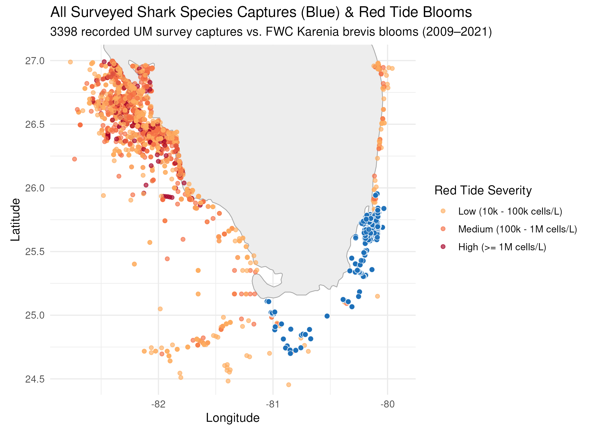
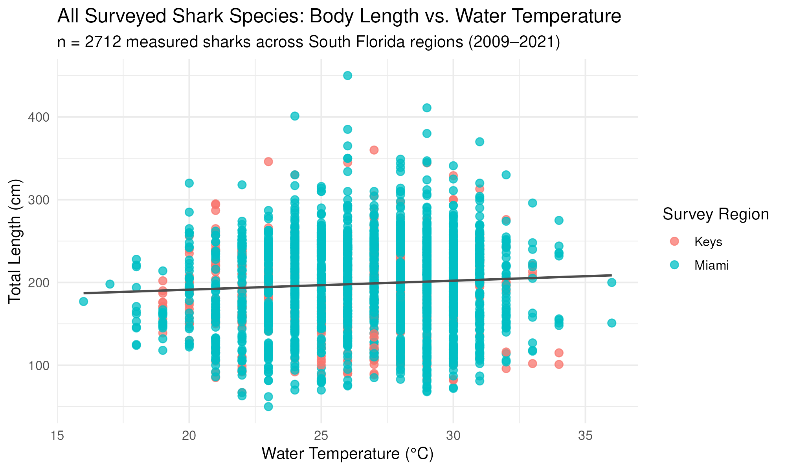
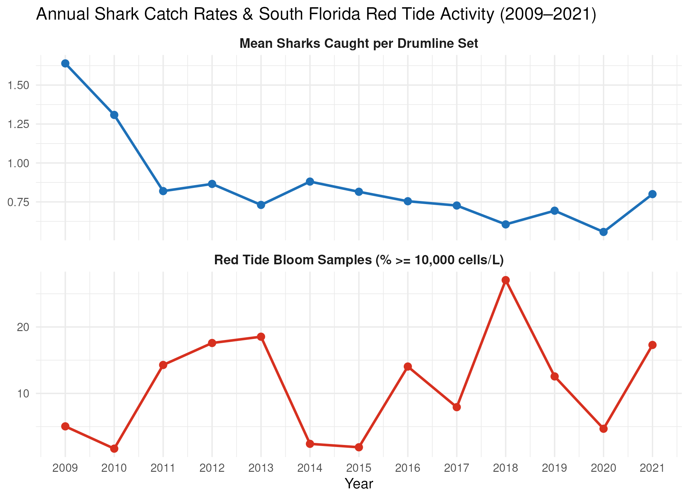

```{r}
#| label: setup
library(tidyverse)
dir.create("images", showWarnings = FALSE)
```

Use the **pull-down menu** below to select a coastal shark species and explore where it was captured relative to South Florida *Karenia brevis* red tide blooms, along with its body length across water temperatures.

```{r}
#| label: generate-species-pngs
# Read water quality measurements per drumline set
sets_raw <- read_csv("data/miami_sharks/SharksBySet.csv") |>
  mutate(
    Date = ymd(str_extract(Sample, "^\\d{4}-\\d{1,2}-\\d{1,2}")),
    Year = year(Date),
    total_sharks = rowSums(across(Nurse:Spinner), na.rm = TRUE)
  )

sets_env <- sets_raw |>
  select(Sample, Temperature, Salinity, DissolvedOxygen, MaximumDepth)

# Join individual shark lengths with set-level water temperature and salinity
sharks_clean <- read_csv("data/miami_sharks/TotalLengthAndSex.csv") |>
  left_join(sets_env, by = "Sample") |>
  mutate(
    Species = str_to_title(Species),
    Date = ymd(str_extract(Sample, "^\\d{4}-\\d{1,2}-\\d{1,2}")),
    Year = year(Date),
    Length_cm = `TotalLength(cm)`
  ) |>
  filter(!is.na(Latitude), !is.na(Longitude))

# Load FWC red tide bloom samples (>= 10,000 cells/L) in South & Southwest Florida (2009-2021)
fwc_files <- list.files("data/fwc_redtide", pattern = "\\.csv$", full.names = TRUE)
redtide_sf <- read_csv(fwc_files, col_types = cols(TIME = col_character())) |>
  mutate(
    SampleDate = as_date(ymd_hms(SAMPLE_DATE, quiet = TRUE)),
    Year = year(SampleDate)
  ) |>
  filter(
    Year >= 2009, Year <= 2021,
    LATITUDE >= 24.4, LATITUDE <= 27.0,
    LONGITUDE >= -82.8, LONGITUDE <= -79.8
  )

redtide_blooms <- redtide_sf |>
  filter(COUNT_ >= 10000) |>
  mutate(
    Severity = case_when(
      COUNT_ >= 1000000 ~ "High (>= 1M cells/L)",
      COUNT_ >= 100000  ~ "Medium (100k - 1M cells/L)",
      TRUE              ~ "Low (10k - 100k cells/L)"
    ),
    Severity = factor(
      Severity,
      levels = c(
        "Low (10k - 100k cells/L)",
        "Medium (100k - 1M cells/L)",
        "High (>= 1M cells/L)"
      )
    )
  )

fl_map <- map_data("state", region = "florida")

# Define the pull-down menu options (all species combined + the 9 most common species)
species_choices <- tribble(
  ~slug,               ~species_filter,       ~label,
  "all",               NA_character_,         "All Surveyed Shark Species",
  "nurse",             "Nurse",               "Nurse Shark",
  "blacktip",          "Blacktip",            "Blacktip Shark",
  "lemon",             "Lemon",               "Lemon Shark",
  "bull",              "Bull",                "Bull Shark",
  "great_hammerhead",  "Great Hammerhead",    "Great Hammerhead Shark",
  "sandbar",           "Sandbar",             "Sandbar Shark",
  "blacknose",         "Blacknose",           "Blacknose Shark",
  "tiger",             "Tiger",               "Tiger Shark",
  "sharpnose",         "Atlantic Sharpnose",  "Atlantic Sharpnose Shark"
)

# Save a static PNG map and a static PNG scatterplot for each pull-down choice
pwalk(species_choices, \(slug, species_filter, label) {
  df <- if (is.na(species_filter)) {
    sharks_clean
  } else {
    filter(sharks_clean, Species == species_filter)
  }

  # 1. Static PNG map showing captures of the selected species alongside red tide blooms
  p_map <- ggplot() +
    geom_polygon(
      data = fl_map,
      aes(x = long, y = lat, group = group),
      fill = "grey93", color = "grey65", linewidth = 0.35
    ) +
    geom_point(
      data = redtide_blooms,
      aes(x = LONGITUDE, y = LATITUDE, color = Severity),
      size = 1.5, alpha = 0.65
    ) +
    geom_point(
      data = df,
      aes(x = Longitude, y = Latitude),
      shape = 21, fill = "#1d70b8", color = "white", stroke = 0.3, size = 2.3, alpha = 0.85
    ) +
    scale_color_manual(
      values = c(
        "Low (10k - 100k cells/L)" = "#fdae61",
        "Medium (100k - 1M cells/L)" = "#f46d43",
        "High (>= 1M cells/L)" = "#a50026"
      )
    ) +
    coord_quickmap(xlim = c(-82.8, -79.9), ylim = c(24.5, 27.0)) +
    labs(
      title = paste0(label, " Captures (Blue) & Red Tide Blooms"),
      subtitle = paste0(nrow(df), " recorded UM survey captures vs. FWC Karenia brevis blooms (2009–2021)"),
      x = "Longitude",
      y = "Latitude",
      color = "Red Tide Severity"
    ) +
    theme_minimal(base_size = 12)

  ggsave(paste0("images/map_", slug, ".png"), p_map, width = 8, height = 5.8, dpi = 250, bg = "white")

  # 2. Static PNG chart showing body length vs. water temperature for the selected species
  df_len <- filter(df, !is.na(Temperature), !is.na(Length_cm))

  p_chart <- ggplot(df_len, aes(x = Temperature, y = Length_cm, color = Region)) +
    geom_point(alpha = 0.75, size = 2.4) +
    geom_smooth(method = "lm", se = FALSE, linewidth = 0.8, color = "grey30") +
    labs(
      title = paste0(label, ": Body Length vs. Water Temperature"),
      subtitle = paste0("n = ", nrow(df_len), " measured sharks across South Florida regions (2009–2021)"),
      x = "Water Temperature (°C)",
      y = "Total Length (cm)",
      color = "Survey Region"
    ) +
    theme_minimal(base_size = 12)

  ggsave(paste0("images/chart_", slug, ".png"), p_chart, width = 8, height = 4.8, dpi = 250, bg = "white")
})
```

## Focus on a Shark Species

```{=html}
<div style="margin: 1rem 0 1.5rem 0; padding: 1rem 1.25rem; background: #f8f9fa; border: 1px solid #dee2e6; border-radius: 8px;">
  <label for="species-select" style="font-weight: 600; margin-right: 0.75rem;">
    Select a Shark Species:
  </label>
  <select id="species-select" class="form-select" style="max-width: 340px; display: inline-block;">
    <option value="all">All Surveyed Shark Species (3,398 captures)</option>
    <option value="nurse">Nurse Shark (1,335 captures)</option>
    <option value="blacktip">Blacktip Shark (650 captures)</option>
    <option value="lemon">Lemon Shark (314 captures)</option>
    <option value="bull">Bull Shark (253 captures)</option>
    <option value="great_hammerhead">Great Hammerhead Shark (238 captures)</option>
    <option value="sandbar">Sandbar Shark (210 captures)</option>
    <option value="blacknose">Blacknose Shark (178 captures)</option>
    <option value="tiger">Tiger Shark (100 captures)</option>
    <option value="sharpnose">Atlantic Sharpnose Shark (67 captures)</option>
  </select>
</div>

<div style="margin-bottom: 2rem;">
  
</div>

<div style="margin-bottom: 2rem;">
  
</div>

<script>
document.getElementById("species-select").addEventListener("change", function(event) {
  const slug = event.target.value;
  document.getElementById("species-map-img").src = "images/map_" + slug + ".png";
  document.getElementById("species-chart-img").src = "images/chart_" + slug + ".png";
});
</script>
```

## Annual Trends: Shark Catch Rate vs. Red Tide Blooms

```{r}
#| label: annual-trends-image
annual_sharks <- sets_raw |>
  filter(!is.na(Year)) |>
  summarize(
    value = mean(total_sharks, na.rm = TRUE),
    .by = Year
  ) |>
  mutate(metric = "Mean Sharks Caught per Drumline Set")

annual_redtide <- redtide_sf |>
  filter(!is.na(Year)) |>
  summarize(
    value = mean(COUNT_ >= 10000, na.rm = TRUE) * 100,
    .by = Year
  ) |>
  mutate(metric = "Red Tide Bloom Samples (% >= 10,000 cells/L)")

annual_plot <- bind_rows(annual_sharks, annual_redtide) |>
  ggplot(aes(x = Year, y = value, color = metric)) +
  geom_line(linewidth = 1) +
  geom_point(size = 2.5) +
  facet_wrap(~metric, ncol = 1, scales = "free_y") +
  scale_x_continuous(breaks = 2009:2021) +
  scale_color_manual(values = c("#1d70b8", "#d7301f"), guide = "none") +
  labs(
    title = "Annual Shark Catch Rates & South Florida Red Tide Activity (2009–2021)",
    x = "Year",
    y = NULL
  ) +
  theme_minimal(base_size = 12) +
  theme(strip.text = element_text(face = "bold", size = 11))

ggsave("images/annual_sharks_redtide.png", annual_plot, width = 8, height = 5.8, dpi = 250, bg = "white")

```
