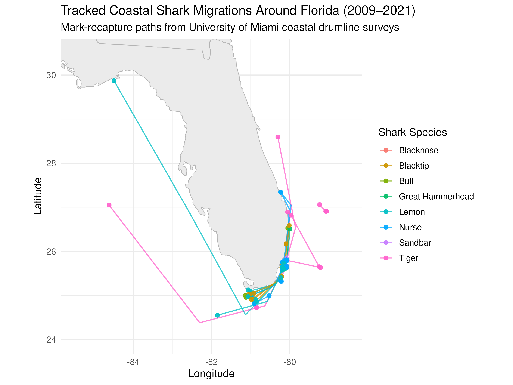

```{r}
#| label: setup
library(tidyverse)
dir.create("images", showWarnings = FALSE)
```

Welcome! This website explores the relationship between coastal shark communities in South Florida and *Karenia brevis* harmful algal blooms (red tide), combining three public datasets:

- **University of Miami Shark Surveys (2009–2021):** Standardized drumline catch, length/sex, and mark-recapture records from South Florida.
- **Florida FWC Red Tide Monitoring (2007–Present):** Water quality and *Karenia brevis* cell count samples across Florida.
- **NOAA HABSOS Archive:** Historical harmful algal bloom observations and environmental measurements across the Gulf of Mexico.

## Coastal Shark Migration Map

```{r}
#| label: shark-migration-plot
shark_tracks <- read_csv("data/miami_sharks/OriginalAndRecaptureLocations.csv")

# Load Florida and neighboring state outlines for the map background
fl_coast <- map_data("state", region = c("florida", "georgia", "alabama"))

migration_plot <- ggplot() +
  geom_polygon(
    data = fl_coast,
    aes(x = long, y = lat, group = group),
    fill = "grey92", color = "grey70", linewidth = 0.3
  ) +
  # Include "E" ocean waypoints in geom_path so migration tracks curve around land
  geom_path(
    data = shark_tracks,
    aes(x = Longitude, y = Latitude, group = TagNumber, color = Species),
    linewidth = 0.6, alpha = 0.75
  ) +
  # Hide artificial "E" waypoints so only real capture/recapture locations appear as points
  geom_point(
    data = filter(shark_tracks, `Original/Recap` != "E"),
    aes(x = Longitude, y = Latitude, color = Species),
    size = 1.8, alpha = 0.9
  ) +
  coord_quickmap(xlim = c(-85.5, -78.5), ylim = c(24, 30.5)) +
  labs(
    title = "Tracked Coastal Shark Migrations Around Florida (2009–2021)",
    subtitle = "Mark-recapture paths from University of Miami coastal drumline surveys",
    x = "Longitude",
    y = "Latitude",
    color = "Shark Species"
  ) +
  theme_minimal(base_size = 12)

ggsave("images/shark_migrations.png", migration_plot, width = 8, height = 6, dpi = 300, bg = "white")

```

Visit the [Graphs](exploration.qmd) tab to compare shark captures and red tide blooms, or the [Correlation](correlation.qmd) tab to see the combined annual data and statistical relationship.
