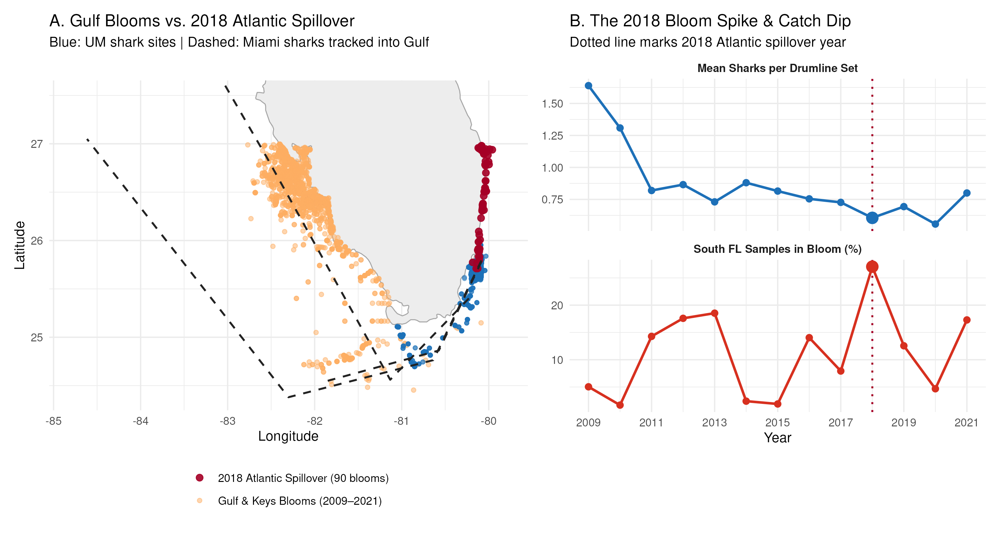

```{r}
#| label: setup
library(tidyverse)
library(patchwork)
dir.create("images", showWarnings = FALSE)
```

For most of the decade between 2009 and 2021, coastal sharks off Miami and Biscayne Bay lived in a natural geographic refuge from Florida's red tide blooms. Combining standardized drumline surveys from the University of Miami (4,351 sets and 3,398 individual shark records) with Florida Fish and Wildlife Conservation Commission (FWC) water monitoring reveals a stark divide across the peninsula: while *Karenia brevis* blooms (`>= 10,000` cells/L) erupt almost annually along Southwest Florida's Gulf coast, South Florida's Atlantic coast (`Longitude > -80.5°`) recorded **zero** bloom samples in 11 out of 13 study years. Even so, mark-recapture tracks show that this boundary is permeable for large coastal predators—Tiger and Lemon sharks tagged off Miami (`-80.1°`) swam hundreds of kilometers around the Florida Keys directly into Gulf waters where blooms are frequent.

```{r}
#| label: story-figure
sets_raw <- read_csv("data/miami_sharks/SharksBySet.csv") |>
  mutate(
    Date = ymd(str_extract(Sample, "^\\d{4}-\\d{1,2}-\\d{1,2}")),
    Year = year(Date),
    total_sharks = rowSums(across(Nurse:Spinner), na.rm = TRUE)
  )

sharks_clean <- read_csv("data/miami_sharks/TotalLengthAndSex.csv") |>
  filter(!is.na(Latitude), !is.na(Longitude))

# Identify sharks tagged on the Atlantic side that crossed into the Gulf of Mexico
shark_tracks <- read_csv("data/miami_sharks/OriginalAndRecaptureLocations.csv")
gulf_tags <- shark_tracks |>
  filter(`Original/Recap` != "E", Longitude < -81.3) |>
  pull(TagNumber) |>
  unique()

gulf_crossers <- shark_tracks |>
  filter(TagNumber %in% gulf_tags)

fwc_files <- list.files("data/fwc_redtide", pattern = "\\.csv$", full.names = TRUE)
redtide_sf <- read_csv(fwc_files, col_types = cols(TIME = col_character())) |>
  mutate(
    SampleDate = as_date(ymd_hms(SAMPLE_DATE, quiet = TRUE)),
    Year = year(SampleDate)
  ) |>
  filter(
    Year >= 2009, Year <= 2021,
    LATITUDE >= 24.4, LATITUDE <= 27.0,
    LONGITUDE >= -82.8, LONGITUDE <= -79.8
  )

blooms_map <- redtide_sf |>
  filter(COUNT_ >= 10000) |>
  mutate(
    zone = if_else(
      Year == 2018 & LONGITUDE > -80.5,
      "2018 Atlantic Spillover (90 blooms)",
      "Gulf & Keys Blooms (2009–2021)"
    )
  )

fl_coast <- map_data("state", region = "florida")

# Panel A: Spatial divide, 2018 Atlantic spillover, and cross-peninsula shark tracks
p_map <- ggplot() +
  geom_polygon(
    data = fl_coast,
    aes(x = long, y = lat, group = group),
    fill = "grey93", color = "grey65", linewidth = 0.35
  ) +
  geom_point(
    data = filter(blooms_map, zone == "Gulf & Keys Blooms (2009–2021)"),
    aes(x = LONGITUDE, y = LATITUDE, color = zone),
    size = 1.3, alpha = 0.5
  ) +
  geom_point(
    data = sharks_clean,
    aes(x = Longitude, y = Latitude),
    color = "#1d70b8", size = 1.2, alpha = 0.45
  ) +
  geom_point(
    data = filter(blooms_map, zone == "2018 Atlantic Spillover (90 blooms)"),
    aes(x = LONGITUDE, y = LATITUDE, color = zone),
    size = 2.1, alpha = 0.9
  ) +
  geom_path(
    data = gulf_crossers,
    aes(x = Longitude, y = Latitude, group = TagNumber),
    color = "#222222", linewidth = 0.7, linetype = "dashed"
  ) +
  scale_color_manual(
    values = c(
      "Gulf & Keys Blooms (2009–2021)" = "#fdae61",
      "2018 Atlantic Spillover (90 blooms)" = "#a50026"
    )
  ) +
  coord_quickmap(xlim = c(-84.8, -79.8), ylim = c(24.4, 27.5)) +
  labs(
    title = "A. Gulf Blooms vs. 2018 Atlantic Spillover",
    subtitle = "Blue: UM shark sites | Dashed: Miami sharks tracked into Gulf",
    x = "Longitude",
    y = "Latitude",
    color = NULL
  ) +
  theme_minimal(base_size = 10.5) +
  theme(legend.position = "bottom", legend.direction = "vertical")

# Panel B: Annual shark catch rate vs. South Florida bloom percentage highlighting 2018
annual_sharks <- sets_raw |>
  filter(!is.na(Year)) |>
  summarize(value = mean(total_sharks, na.rm = TRUE), .by = Year) |>
  mutate(panel = "Mean Sharks per Drumline Set")

annual_blooms <- redtide_sf |>
  filter(!is.na(Year)) |>
  summarize(value = mean(COUNT_ >= 10000, na.rm = TRUE) * 100, .by = Year) |>
  mutate(panel = "South FL Samples in Bloom (%)")

annual_df <- bind_rows(annual_sharks, annual_blooms) |>
  mutate(is_2018 = Year == 2018)

p_time <- ggplot(annual_df, aes(x = Year, y = value)) +
  geom_vline(xintercept = 2018, linetype = "dotted", color = "#a50026", linewidth = 0.7) +
  geom_line(aes(color = panel), linewidth = 0.9) +
  geom_point(aes(color = panel, size = is_2018)) +
  facet_wrap(~panel, ncol = 1, scales = "free_y") +
  scale_x_continuous(breaks = seq(2009, 2021, by = 2)) +
  scale_color_manual(values = c("#1d70b8", "#d7301f"), guide = "none") +
  scale_size_manual(values = c(`FALSE` = 2, `TRUE` = 3.8), guide = "none") +
  labs(
    title = "B. The 2018 Bloom Spike & Catch Dip",
    subtitle = "Dotted line marks 2018 Atlantic spillover year",
    x = "Year",
    y = NULL
  ) +
  theme_minimal(base_size = 10.5) +
  theme(strip.text = element_text(face = "bold"))

story_combined <- p_map + p_time + plot_layout(widths = c(1.15, 1))

ggsave("images/story_figure.png", story_combined, width = 10.5, height = 5.6, dpi = 300, bg = "white")

```

That geographic shelter broke down dramatically in **2018** (Panel A, dark red points). During the severe 2017–2018 Southwest Florida red tide crisis, Loop Current and Florida Current eddies carried *Karenia brevis* cells around the Florida Keys and up the Atlantic coast into Miami-Dade, Broward, and Palm Beach waters. Out of all 95 Atlantic-coast bloom samples recorded in South Florida across the entire 13-year FWC archive, **90 occurred in the autumn of 2018 alone**, pushing overall South Florida bloom prevalence to a study-wide peak of **27.1%** of all water samples (with concentrations exceeding 50 million cells/L).

At the same time, the University of Miami drumline survey recorded a clear dip in coastal shark catch rates, falling from 0.73–0.88 sharks per set during the low-bloom years of 2014–2017 down to **0.61 sharks per set in 2018** (Panel B). Because *Karenia brevis* neurotoxins (brevetoxins) cause massive fish kills and depleted dissolved oxygen in nearshore waters, mobile coastal sharks frequently move offshore or along the coast to avoid toxic blooms, while slower-moving benthic residents face higher exposure. Together, the spatial map, migration tracks, and annual catch record show why South Florida's shark community cannot be treated as isolated from Gulf of Mexico harmful algal blooms: sharks cross between both coasts on their own, and in extreme bloom years, red tide crosses right over to them.
